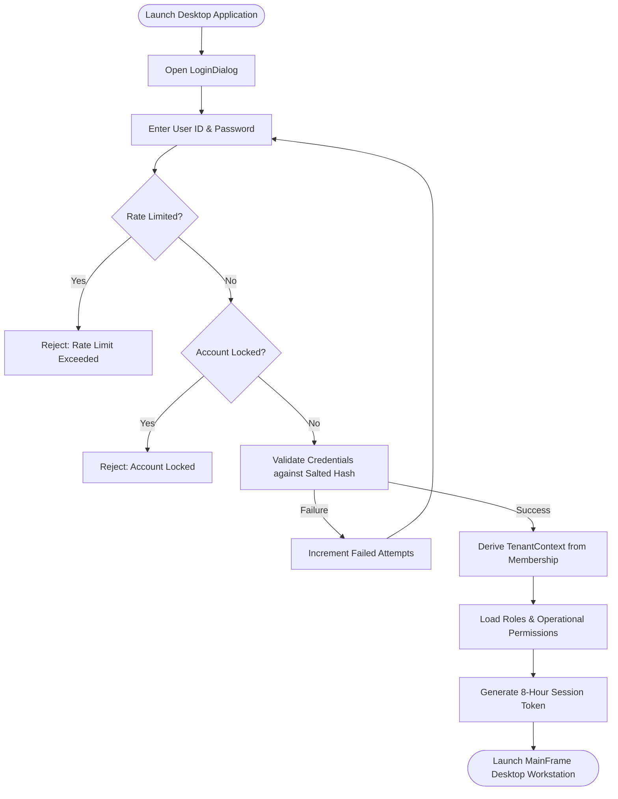
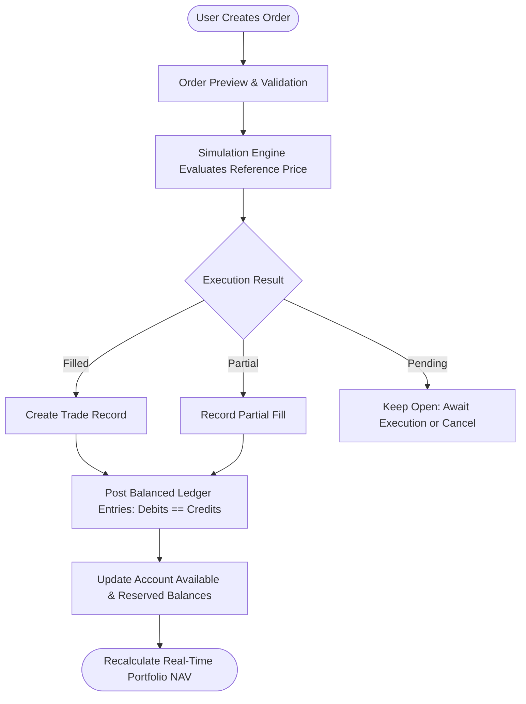
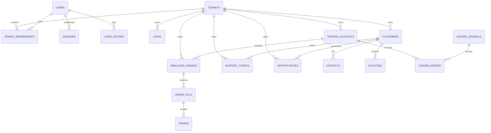

# CryptoVista X Enterprise — System Architecture & Engineering Blueprint

**Document Version:** 4.2.0  
**Target Platform:** Java 21 LTS (Modular Monolith)  
**Database:** Shared MySQL 8 (InnoDB) with `tenant_id` Discriminator  
**UI Standard:** Pure Java Swing Desktop Workstation (Zero HTML Artifacts)  

---

## 1. System Architecture Overview

CryptoVista X Enterprise is engineered as a secure, multi-tenant enterprise desktop platform combining digital asset intelligence, deterministic simulated crypto trading, portfolio accounting, and customer relationship management.

```text
===================================================================================
                             DESKTOP PRESENTATION LAYER (Java Swing)
    LoginDialog · MainFrame · NavigationSidebar · TopBar · RectangularButton
    Dashboards · Markets · Order Book · Portfolio · Customer 360 · Support SLA · Admin
===================================================================================
                                       │ Direct Application Service Invocations
                                       ▼
===================================================================================
                                APPLICATION SERVICE LAYER
    AuthService (User ID + Password ONLY, Rate Limiting, Account Lockout)
    TenantContext (ThreadLocal) Enforcement │ Idempotency & Validation Interceptors
    Application Services (CrmService, TicketService, WorkflowService, PortfolioService)
===================================================================================
                                       │ Domain Interfaces
                                       ▼
===================================================================================
                                    DOMAIN LAYER
    Market Intelligence Engine             │ Simulated Trading & Matching Engine
    Double-Entry Balanced Financial Math   │ Portfolio Real-Time NAV Calculator
    Customer 360 & Lead Conversion Logic   │ Ticket SLA & Escalation Evaluator
===================================================================================
                                       │ Repository SPIs
                                       ▼
===================================================================================
                              INFRASTRUCTURE & PERSISTENCE
    MySQL 8 JDBC Data Repositories         │ InMemory Enterprise Repositories
    Salted Cryptographic Password Vault    │ Append-Only Audit Log Emitter
===================================================================================
                                       │ SQL Statements (V1 & V2 DDL)
                                       ▼
===================================================================================
                             PERSISTENCE TIER (MySQL 8)
                Shared Database: 39 Indexed Multi-Tenant Relational Tables
===================================================================================
```

---

## 2. Core Workflows & Lifecycles

### 2.1 Pure User ID & Password Authentication Lifecycle
CryptoVista X enforces single-step User ID and Password authentication. Zero MFA, zero OTP, zero SMS or email codes during login.



### 2.2 Simulated Order Execution & Financial Accounting



### 2.3 Relational Entity Model (39 Tables)



---

## 3. Desktop Application Packaging & Verification

- **Main Entry Point:** [`com.cryptovista.CryptoVistaApp`](file:///c:/Users/narsi/Downloads/java-project/src/main/java/com/cryptovista/CryptoVistaApp.java)
- **Packaged Executable:** [`cryptovista-x.jar`](file:///c:/Users/narsi/Downloads/java-project/cryptovista-x.jar)
- **Launch Command:**
  ```powershell
  & "C:\Program Files\Eclipse Adoptium\jdk-21.0.13.9-hotspot\bin\java.exe" -jar cryptovista-x.jar
  ```
- **Harness Verification:** `python test_enterprise_suite.py` (100% verified green across all 4 suites).
