# CryptoVista X Enterprise — Complete Database Architecture & ERD Specification

**Document Version:** 4.0 (Enterprise Production Standard)  
**Database Engine:** MySQL 8.0+ (InnoDB)  
**Charset & Collation:** `utf8mb4` / `utf8mb4_unicode_ci`  
**Architecture:** Shared Multi-Tenant Schema with Discriminator Column (`tenant_id`)  
**Design Reference:** Groww (simplicity and clean hierarchy) + CryptoVista X Original Identity  

---

## 1. Executive Summary & Design Principles

CryptoVista X Enterprise persists state for 16 core business domains within a shared MySQL 8 database. To guarantee strict multi-tenant isolation, enterprise data confidentiality, and financial accuracy, the schema adheres to four inviolable engineering principles:

1. **Strict Multi-Tenant Isolation:**
   - Every organizational table contains a `tenant_id VARCHAR(64)` discriminator column.
   - Primary keys or unique business constraints are composite: `(tenant_id, id)` or `(tenant_id, business_key)`.
   - Every foreign key either enforces composite tenant binding `FOREIGN KEY (tenant_id, parent_id) REFERENCES parent_table (tenant_id, id)` or is strictly validated at the transactional service boundary.
   - Tenant deletion is protected via `ON DELETE RESTRICT` on tenant roots, while tenant-scoped sub-entities (e.g. internal notes, order fills) cascade delete (`ON DELETE CASCADE`) to avoid orphaned records upon legal tenant purges.

2. **Immutable Double-Entry Financial Accounting:**
   - Simulated trading balances are never updated in isolation.
   - Every simulated fill generates paired, balanced ledger journal entries:
     $$\sum \text{Debit} = \sum \text{Credit}$$
   - Ledger journals (`ledger_journals`) and postings (`ledger_entries`) are strictly append-only. No `UPDATE` or `DELETE` statements are ever executed against financial journals.

3. **High-Precision Financial Math:**
   - Fiat currencies (INR / USD) are stored as `DECIMAL(18, 4)`.
   - Crypto asset quantities and fractions (e.g., BTC Satoshi precision) are stored as `DECIMAL(18, 8)`.
   - Percentages and probabilities are stored as `DECIMAL(5, 2)` or `INT`.

4. **Information Segregation & Confidentiality:**
   - Support internal notes (`ticket_internal_notes`) are stored in an isolated table with separate access policies. They are never joined in customer-facing communication queries (`ticket_messages`).

---

## 2. Complete Entity Relationship Diagram (ERD)

```mermaid
erDiagram
    TENANTS ||--o{ TENANT_MEMBERSHIPS : contains
    USERS ||--o{ TENANT_MEMBERSHIPS : joins
    TENANTS ||--o{ TENANT_SETTINGS : configures
    USERS ||--o{ MFA_CREDENTIALS : enrolls
    USERS ||--o{ SESSIONS : establishes
    
    TENANTS ||--o{ ROLES : defines
    ROLES ||--o{ ROLE_PERMISSIONS : grants
    PERMISSIONS ||--o{ ROLE_PERMISSIONS : mapped_to
    USERS ||--o{ USER_ROLES : assigned
    ROLES ||--o{ USER_ROLES : given_to

    TENANTS ||--o{ LEADS : owns
    TENANTS ||--o{ CUSTOMERS : owns
    CUSTOMERS ||--o{ CONTACTS : has
    CUSTOMERS ||--o{ OPPORTUNITIES : generates
    TENANTS ||--o{ OPPORTUNITIES : owns
    CUSTOMERS ||--o{ ACTIVITIES : records
    CUSTOMERS ||--o{ ONBOARDING_CASES : progresses
    
    CUSTOMERS ||--o{ SUPPORT_TICKETS : raises
    TENANTS ||--o{ SUPPORT_TICKETS : owns
    SUPPORT_TICKETS ||--o{ TICKET_MESSAGES : communicates
    SUPPORT_TICKETS ||--o{ TICKET_INTERNAL_NOTES : annotates
    TENANTS ||--o{ SLA_POLICIES : enforces

    TENANTS ||--o{ TRADING_ACCOUNTS : owns
    TRADING_ACCOUNTS ||--o{ SIMULATED_HOLDINGS : holds
    TRADING_ACCOUNTS ||--o{ SIMULATED_ORDERS : submits
    TENANTS ||--o{ SIMULATED_ORDERS : owns
    SIMULATED_ORDERS ||--o{ ORDER_FILLS : receives
    ORDER_FILLS ||--o{ TRADES : creates
    TRADING_ACCOUNTS ||--o{ LEDGER_ENTRIES : records
    LEDGER_JOURNALS ||--o{ LEDGER_ENTRIES : groups
    TRADING_ACCOUNTS ||--o{ PORTFOLIO_SNAPSHOTS : snapshots

    CRYPTO_ASSETS ||--o{ MARKET_PRICES : priced_at
    CRYPTO_ASSETS ||--o{ HISTORICAL_PRICES : tracks
    TENANTS ||--o{ WATCHLISTS : configures
    WATCHLISTS ||--o{ WATCHLIST_ITEMS : lists
    CRYPTO_ASSETS ||--o{ WATCHLIST_ITEMS : references

    TENANTS ||--o{ WORKFLOW_DEFINITIONS : configures
    WORKFLOW_DEFINITIONS ||--o{ WORKFLOW_INSTANCES : executes
    WORKFLOW_INSTANCES ||--o{ WORKFLOW_APPROVALS : awaits
    TENANTS ||--o{ DOCUMENTS : archives
    TENANTS ||--o{ AUDIT_LOG : tracks
```



---

## 3. Detailed Data Dictionary & Table Specifications

### 3.1 Domain 1: Multi-Tenancy & Tenant Governance

#### 1. `tenants`
Root organizational entity. All tenant-scoped data cascades from this identity.

| Column | Data Type | Nullable | Default | Constraints & Description |
| :--- | :--- | :--- | :--- | :--- |
| `id` | `VARCHAR(64)` | No | - | **Primary Key**. Organization code (e.g. `TENANT-APEX-01`). |
| `name` | `VARCHAR(255)` | No | - | Organization legal name. |
| `tier` | `VARCHAR(32)` | No | `'ENTERPRISE'` | `ENTERPRISE`, `INSTITUTIONAL`, `PRO`. |
| `status` | `VARCHAR(32)` | No | `'ACTIVE'` | `ACTIVE`, `SUSPENDED`, `OFFBOARDED`. |
| `max_users` | `INT` | No | `50` | Maximum seat allocation. |
| `base_currency` | `VARCHAR(8)` | No | `'INR'` | Base accounting currency. |
| `created_at` | `TIMESTAMP` | No | `CURRENT_TIMESTAMP` | Audit timestamp. |
| `updated_at` | `TIMESTAMP` | No | `CURRENT_TIMESTAMP ON UPDATE` | Modification timestamp. |

*Indexes:*
- `PRIMARY KEY (id)`
- `INDEX idx_tenants_status (status)`

#### 2. `tenant_memberships`
Explicit association table linking global/enterprise users to tenant organizations.

| Column | Data Type | Nullable | Default | Constraints & Description |
| :--- | :--- | :--- | :--- | :--- |
| `tenant_id` | `VARCHAR(64)` | No | - | **PK (Comp 1)**, **FK** to `tenants(id)`. |
| `user_id` | `VARCHAR(64)` | No | - | **PK (Comp 2)**, **FK** to `users(id)`. |
| `membership_role` | `VARCHAR(64)` | No | `'MEMBER'` | Role in tenant context. |
| `status` | `VARCHAR(32)` | No | `'ACTIVE'` | Membership state. |
| `joined_at` | `TIMESTAMP` | No | `CURRENT_TIMESTAMP` | Association timestamp. |

*Indexes:*
- `PRIMARY KEY (tenant_id, user_id)`
- `INDEX idx_memberships_user (user_id)`

#### 3. `tenant_settings`
Tenant-specific configuration key-value storage.

| Column | Data Type | Nullable | Default | Constraints & Description |
| :--- | :--- | :--- | :--- | :--- |
| `tenant_id` | `VARCHAR(64)` | No | - | **PK (Comp 1)**, **FK** to `tenants(id)`. |
| `setting_key` | `VARCHAR(128)` | No | - | **PK (Comp 2)**. Config key name. |
| `setting_value` | `TEXT` | Yes | `NULL` | JSON or string value. |
| `is_encrypted` | `BOOLEAN` | No | `FALSE` | AES-256 encrypted flag. |
| `updated_at` | `TIMESTAMP` | No | `CURRENT_TIMESTAMP ON UPDATE` | Modification timestamp. |

---

### 3.2 Domain 2: Identity, Access Management & Authentication (Flowchart 1)

#### 4. `users`
Authenticated operators, analysts, traders, and administrative identities.

| Column | Data Type | Nullable | Default | Constraints & Description |
| :--- | :--- | :--- | :--- | :--- |
| `tenant_id` | `VARCHAR(64)` | No | - | **PK (Comp 1)**, **FK** to `tenants(id)`. |
| `id` | `VARCHAR(64)` | No | - | **PK (Comp 2)**. User UUID. |
| `email` | `VARCHAR(255)` | No | - | Corporate email address. |
| `password_hash` | `VARCHAR(255)` | No | - | Argon2id / BCrypt salt and hash. |
| `totp_secret_enc`| `VARCHAR(255)` | Yes | `NULL` | Base32 TOTP secret (AES-256 encrypted). |
| `mfa_enabled` | `BOOLEAN` | No | `TRUE` | RFC 6238 TOTP enforcement flag. |
| `role` | `VARCHAR(64)` | No | `'OPERATOR'` | Primary role identifier. |
| `status` | `VARCHAR(32)` | No | `'ACTIVE'` | `ACTIVE`, `LOCKED`, `DEACTIVATED`. |
| `failed_logins` | `INT` | No | `0` | Consecutive failed attempts counter. |
| `created_at` | `TIMESTAMP` | No | `CURRENT_TIMESTAMP` | Account creation timestamp. |
| `updated_at` | `TIMESTAMP` | No | `CURRENT_TIMESTAMP ON UPDATE` | Last modification timestamp. |

*Indexes:*
- `PRIMARY KEY (tenant_id, id)`
- `UNIQUE KEY uk_tenant_user_email (tenant_id, email)`
- `INDEX idx_users_email (email)`

#### 5. `mfa_credentials`
Enrolled TOTP authenticator metadata and replay attack prevention.

| Column | Data Type | Nullable | Default | Constraints & Description |
| :--- | :--- | :--- | :--- | :--- |
| `tenant_id` | `VARCHAR(64)` | No | - | **PK (Comp 1)**. |
| `user_id` | `VARCHAR(64)` | No | - | **PK (Comp 2)**. |
| `totp_secret_enc`| `VARCHAR(255)` | No | - | Encrypted TOTP secret. |
| `last_used_step`| `BIGINT` | No | `0` | Replay protection (RFC 6238 time step). |
| `is_verified` | `BOOLEAN` | No | `TRUE` | Enrollment confirmation flag. |
| `enrolled_at` | `TIMESTAMP` | No | `CURRENT_TIMESTAMP` | Activation timestamp. |

*Foreign Key:*
- `CONSTRAINT fk_mfa_user FOREIGN KEY (tenant_id, user_id) REFERENCES users (tenant_id, id) ON DELETE CASCADE`

#### 6. `sessions`
Enterprise session state with cryptographically secure session tokens.

| Column | Data Type | Nullable | Default | Constraints & Description |
| :--- | :--- | :--- | :--- | :--- |
| `session_id_hash` | `VARCHAR(64)`| No | - | **Primary Key**. SHA-256 hash of token. |
| `tenant_id` | `VARCHAR(64)` | No | - | Associated tenant ID. |
| `user_id` | `VARCHAR(64)` | No | - | Associated user ID. |
| `ip_address` | `VARCHAR(45)` | Yes | `NULL` | Client IPv4 / IPv6 address. |
| `user_agent` | `VARCHAR(255)`| Yes | `NULL` | Client workstation identification. |
| `expires_at` | `TIMESTAMP` | No | - | Hard session expiration. |
| `revoked` | `BOOLEAN` | No | `FALSE` | Explicit administrative revocation. |
| `created_at` | `TIMESTAMP` | No | `CURRENT_TIMESTAMP` | Session start time. |

*Indexes:*
- `PRIMARY KEY (session_id_hash)`
- `INDEX idx_sessions_tenant_user (tenant_id, user_id)`
- `INDEX idx_sessions_expires (expires_at)`

#### 7. `roles` & 8. `permissions` & 9. `role_permissions` & 10. `user_roles`
Fine-grained enterprise Role-Based Access Control (RBAC).

```sql
CREATE TABLE roles (
    tenant_id VARCHAR(64) NOT NULL,
    id VARCHAR(64) NOT NULL,
    role_code VARCHAR(64) NOT NULL,
    role_name VARCHAR(255) NOT NULL,
    description TEXT,
    is_system BOOLEAN NOT NULL DEFAULT FALSE,
    PRIMARY KEY (tenant_id, id),
    UNIQUE KEY uk_tenant_role_code (tenant_id, role_code)
);

CREATE TABLE permissions (
    id VARCHAR(64) PRIMARY KEY,
    module VARCHAR(64) NOT NULL,
    action VARCHAR(64) NOT NULL,
    description VARCHAR(255)
);

CREATE TABLE role_permissions (
    tenant_id VARCHAR(64) NOT NULL,
    role_id VARCHAR(64) NOT NULL,
    permission_id VARCHAR(64) NOT NULL,
    PRIMARY KEY (tenant_id, role_id, permission_id),
    CONSTRAINT fk_rp_role FOREIGN KEY (tenant_id, role_id) REFERENCES roles (tenant_id, id) ON DELETE CASCADE,
    CONSTRAINT fk_rp_perm FOREIGN KEY (permission_id) REFERENCES permissions (id) ON DELETE CASCADE
);

CREATE TABLE user_roles (
    tenant_id VARCHAR(64) NOT NULL,
    user_id VARCHAR(64) NOT NULL,
    role_id VARCHAR(64) NOT NULL,
    granted_by VARCHAR(64),
    granted_at TIMESTAMP DEFAULT CURRENT_TIMESTAMP,
    PRIMARY KEY (tenant_id, user_id, role_id),
    CONSTRAINT fk_ur_user FOREIGN KEY (tenant_id, user_id) REFERENCES users (tenant_id, id) ON DELETE CASCADE,
    CONSTRAINT fk_ur_role FOREIGN KEY (tenant_id, role_id) REFERENCES roles (tenant_id, id) ON DELETE CASCADE
);
```

---

### 3.3 Domain 3: Market Intelligence (Flowchart 3)

#### 11. `crypto_assets`
Authoritative catalogue of digital assets tracked by the platform.

| Column | Data Type | Nullable | Default | Constraints & Description |
| :--- | :--- | :--- | :--- | :--- |
| `id` | `VARCHAR(64)` | No | - | **Primary Key** (e.g. `ASSET-BTC`). |
| `symbol` | `VARCHAR(16)` | No | - | Ticker code (e.g. `BTC`, `ETH`, `SOL`). |
| `name` | `VARCHAR(128)` | No | - | Full asset name (e.g. `Bitcoin`). |
| `asset_class` | `VARCHAR(32)` | No | `'LAYER_1'` | `LAYER_1`, `DEFI`, `STABLECOIN`. |
| `base_currency` | `VARCHAR(8)` | No | `'INR'` | Reference quote currency. |
| `is_active` | `BOOLEAN` | No | `TRUE` | Trading eligibility flag. |
| `created_at` | `TIMESTAMP` | No | `CURRENT_TIMESTAMP` | Registration date. |

*Indexes:*
- `PRIMARY KEY (id)`
- `UNIQUE KEY uk_crypto_symbol (symbol)`

#### 12. `market_prices`
Normalized reference market quotes (hybrid external provider + deterministic mock).

| Column | Data Type | Nullable | Default | Constraints & Description |
| :--- | :--- | :--- | :--- | :--- |
| `symbol` | `VARCHAR(16)` | No | - | **Primary Key**, matches `crypto_assets(symbol)`. |
| `price_inr` | `DECIMAL(18, 4)`| No | - | Latest reference price. |
| `change_24h_pct`| `DECIMAL(6, 2)` | No | - | 24-hour percentage change. |
| `high_24h_inr` | `DECIMAL(18, 4)`| No | - | 24-hour rolling high. |
| `low_24h_inr` | `DECIMAL(18, 4)`| No | - | 24-hour rolling low. |
| `volume_24h_inr`| `DECIMAL(24, 2)`| No | - | 24-hour total trading volume. |
| `source_type` | `VARCHAR(32)` | No | `'MOCK'` | `EXTERNAL_API`, `DETERMINISTIC_MOCK`. |
| `provider_name` | `VARCHAR(64)` | No | `'MOCK_ENGINE'`| Provider identifier. |
| `is_mock` | `BOOLEAN` | No | `TRUE` | Disclosed synthetic data flag. |
| `market_timestamp`| `TIMESTAMP` | No | - | Source timestamp. |
| `fetched_at` | `TIMESTAMP` | No | `CURRENT_TIMESTAMP` | Ingestion timestamp. |

*Indexes:*
- `PRIMARY KEY (symbol)`
- `INDEX idx_market_prices_source (source_type, is_mock)`

#### 13. `historical_prices`
Historical OHLCV candle data for charting and technical analysis.

| Column | Data Type | Nullable | Default | Constraints & Description |
| :--- | :--- | :--- | :--- | :--- |
| `id` | `BIGINT AUTO_INC` | No | - | **Primary Key**. |
| `symbol` | `VARCHAR(16)` | No | - | Asset symbol. |
| `timeframe` | `VARCHAR(16)` | No | `'1D'` | `1M`, `5M`, `1H`, `1D`, `1W`. |
| `open_price` | `DECIMAL(18, 4)`| No | - | Candle open. |
| `high_price` | `DECIMAL(18, 4)`| No | - | Candle high. |
| `low_price` | `DECIMAL(18, 4)`| No | - | Candle low. |
| `close_price` | `DECIMAL(18, 4)`| No | - | Candle close. |
| `volume` | `DECIMAL(24, 4)`| No | - | Volume during interval. |
| `candle_time` | `TIMESTAMP` | No | - | Candle start timestamp. |

*Indexes:*
- `PRIMARY KEY (id)`
- `UNIQUE KEY uk_candle (symbol, timeframe, candle_time)`
- `INDEX idx_candle_lookup (symbol, timeframe, candle_time DESC)`

#### 14. `watchlists` & 15. `watchlist_items`
User-curated asset monitoring lists.

```sql
CREATE TABLE watchlists (
    tenant_id VARCHAR(64) NOT NULL,
    id VARCHAR(64) NOT NULL,
    user_id VARCHAR(64) NOT NULL,
    name VARCHAR(128) NOT NULL,
    is_default BOOLEAN NOT NULL DEFAULT FALSE,
    created_at TIMESTAMP DEFAULT CURRENT_TIMESTAMP,
    PRIMARY KEY (tenant_id, id),
    INDEX idx_wl_user (tenant_id, user_id)
);

CREATE TABLE watchlist_items (
    tenant_id VARCHAR(64) NOT NULL,
    watchlist_id VARCHAR(64) NOT NULL,
    symbol VARCHAR(16) NOT NULL,
    display_order INT NOT NULL DEFAULT 0,
    added_at TIMESTAMP DEFAULT CURRENT_TIMESTAMP,
    PRIMARY KEY (tenant_id, watchlist_id, symbol),
    CONSTRAINT fk_wli_watchlist FOREIGN KEY (tenant_id, watchlist_id) REFERENCES watchlists (tenant_id, id) ON DELETE CASCADE
);
```

---

### 3.4 Domain 4: Simulated Trading & Balanced Financial Ledger (Flowchart 2 & ERD 5)

#### 16. `simulated_accounts`
Virtual trading balance accounts (zero custodial risk, virtual funds only).

| Column | Data Type | Nullable | Default | Constraints & Description |
| :--- | :--- | :--- | :--- | :--- |
| `tenant_id` | `VARCHAR(64)` | No | - | **PK (Comp 1)**. |
| `id` | `VARCHAR(64)` | No | - | **PK (Comp 2)**. Virtual account ID. |
| `user_id` | `VARCHAR(64)` | No | - | Account owner. |
| `account_number` | `VARCHAR(64)` | No | - | Unique account identifier. |
| `currency` | `VARCHAR(16)` | No | `'INR'` | Virtual currency unit. |
| `available_cash`| `DECIMAL(18, 4)`| No | `10000000.0000`| Free cash balance (e.g. ₹1.00 Cr demo). |
| `reserved_cash` | `DECIMAL(18, 4)`| No | `0.0000` | Escrowed cash in pending buy orders. |
| `status` | `VARCHAR(32)` | No | `'ACTIVE'` | Account status. |
| `created_at` | `TIMESTAMP` | No | `CURRENT_TIMESTAMP` | Account creation timestamp. |

*Indexes:*
- `PRIMARY KEY (tenant_id, id)`
- `UNIQUE KEY uk_tenant_account_num (tenant_id, account_number)`
- `INDEX idx_accounts_user (tenant_id, user_id)`

#### 17. `simulated_holdings`
Asset balances held in simulated trading accounts.

| Column | Data Type | Nullable | Default | Constraints & Description |
| :--- | :--- | :--- | :--- | :--- |
| `tenant_id` | `VARCHAR(64)` | No | - | **PK (Comp 1)**. |
| `account_id` | `VARCHAR(64)` | No | - | **PK (Comp 2)**. |
| `symbol` | `VARCHAR(16)` | No | - | **PK (Comp 3)**. Crypto ticker symbol. |
| `quantity` | `DECIMAL(18, 8)`| No | `0.00000000` | Total virtual token balance. |
| `reserved_qty` | `DECIMAL(18, 8)`| No | `0.00000000` | Locked tokens in open sell orders. |
| `cost_basis_inr`| `DECIMAL(18, 4)`| No | `0.0000` | Weighted average cost basis in INR. |
| `updated_at` | `TIMESTAMP` | No | `CURRENT_TIMESTAMP ON UPDATE` | Balance change timestamp. |

*Foreign Key:*
- `CONSTRAINT fk_holdings_account FOREIGN KEY (tenant_id, account_id) REFERENCES simulated_accounts (tenant_id, id) ON DELETE CASCADE`

#### 18. `simulated_orders`
Virtual orders submitted to the internal execution simulation engine.

| Column | Data Type | Nullable | Default | Constraints & Description |
| :--- | :--- | :--- | :--- | :--- |
| `tenant_id` | `VARCHAR(64)` | No | - | **PK (Comp 1)**. |
| `id` | `VARCHAR(64)` | No | - | **PK (Comp 2)**. Order ID. |
| `account_id` | `VARCHAR(64)` | No | - | Source trading account. |
| `symbol` | `VARCHAR(16)` | No | - | Target crypto asset. |
| `side` | `VARCHAR(8)` | No | - | `BUY` or `SELL`. |
| `order_type` | `VARCHAR(16)` | No | `'MARKET'` | `MARKET`, `LIMIT`, `STOP_LIMIT`. |
| `quantity` | `DECIMAL(18, 8)`| No | - | Requested token quantity. |
| `limit_price` | `DECIMAL(18, 4)`| Yes | `NULL` | Price trigger for limit orders. |
| `filled_quantity`| `DECIMAL(18, 8)`| No | `0.00000000` | Executed token quantity. |
| `avg_fill_price`| `DECIMAL(18, 4)`| Yes | `NULL` | Volume-weighted execution price. |
| `status` | `VARCHAR(32)` | No | `'NEW'` | `NEW`, `FILLED`, `PARTIAL`, `CANCELLED`, `REJECTED`. |
| `idempotency_key`| `VARCHAR(128)` | Yes | `NULL` | Client retry deduplication key. |
| `created_at` | `TIMESTAMP` | No | `CURRENT_TIMESTAMP` | Order entry timestamp. |
| `updated_at` | `TIMESTAMP` | No | `CURRENT_TIMESTAMP ON UPDATE` | Status update timestamp. |

*Indexes:*
- `PRIMARY KEY (tenant_id, id)`
- `UNIQUE KEY uk_order_idempotency (tenant_id, idempotency_key)`
- `INDEX idx_orders_account (tenant_id, account_id)`
- `INDEX idx_orders_status (tenant_id, status)`

#### 19. `order_fills`
Individual execution fills resulting from order processing.

| Column | Data Type | Nullable | Default | Constraints & Description |
| :--- | :--- | :--- | :--- | :--- |
| `tenant_id` | `VARCHAR(64)` | No | - | **PK (Comp 1)**. |
| `id` | `VARCHAR(64)` | No | - | **PK (Comp 2)**. Fill ID. |
| `order_id` | `VARCHAR(64)` | No | - | Associated order ID. |
| `fill_quantity` | `DECIMAL(18, 8)`| No | - | Token amount filled. |
| `fill_price` | `DECIMAL(18, 4)`| No | - | Execution price per token. |
| `fee_amount` | `DECIMAL(18, 4)`| No | `0.0000` | Calculated execution fee. |
| `executed_at` | `TIMESTAMP` | No | `CURRENT_TIMESTAMP` | Fill timestamp. |

*Indexes:*
- `PRIMARY KEY (tenant_id, id)`
- `INDEX idx_fills_order (tenant_id, order_id)`
- `CONSTRAINT fk_fills_order FOREIGN KEY (tenant_id, order_id) REFERENCES simulated_orders (tenant_id, id) ON DELETE CASCADE`

#### 20. `trades`
Executed bilateral trade records generated from order fills (ERD Diagram 5).

| Column | Data Type | Nullable | Default | Constraints & Description |
| :--- | :--- | :--- | :--- | :--- |
| `tenant_id` | `VARCHAR(64)` | No | - | **PK (Comp 1)**. |
| `id` | `VARCHAR(64)` | No | - | **PK (Comp 2)**. Trade ID. |
| `order_id` | `VARCHAR(64)` | No | - | Originating order. |
| `fill_id` | `VARCHAR(64)` | No | - | Associated fill. |
| `account_id` | `VARCHAR(64)` | No | - | Trading account. |
| `symbol` | `VARCHAR(16)` | No | - | Asset symbol. |
| `side` | `VARCHAR(8)` | No | - | `BUY` or `SELL`. |
| `quantity` | `DECIMAL(18, 8)`| No | - | Final filled quantity. |
| `price` | `DECIMAL(18, 4)`| No | - | Execution price. |
| `total_value` | `DECIMAL(18, 4)`| No | - | Total trade cash value (`quantity * price`). |
| `fee` | `DECIMAL(18, 4)`| No | `0.0000` | Transaction fee. |
| `trade_time` | `TIMESTAMP` | No | `CURRENT_TIMESTAMP` | Trade execution time. |

*Indexes:*
- `PRIMARY KEY (tenant_id, id)`
- `INDEX idx_trades_account (tenant_id, account_id, trade_time DESC)`

#### 21. `ledger_journals` & 22. `ledger_entries`
Immutable double-entry financial ledger guaranteeing balance conservation.

```sql
CREATE TABLE ledger_journals (
    tenant_id VARCHAR(64) NOT NULL,
    id VARCHAR(64) NOT NULL,
    journal_type VARCHAR(64) NOT NULL, -- e.g. 'TRADE_SETTLEMENT', 'DEPOSIT', 'FEE'
    description VARCHAR(255) NOT NULL,
    reference_id VARCHAR(64) NOT NULL, -- Order ID, Trade ID, or Deposit Ref
    is_balanced BOOLEAN NOT NULL DEFAULT TRUE,
    created_at TIMESTAMP DEFAULT CURRENT_TIMESTAMP,
    PRIMARY KEY (tenant_id, id),
    INDEX idx_journals_ref (tenant_id, reference_id)
);

CREATE TABLE ledger_entries (
    id BIGINT AUTO_INCREMENT PRIMARY KEY,
    tenant_id VARCHAR(64) NOT NULL,
    journal_id VARCHAR(64) NOT NULL,
    account_id VARCHAR(64) NOT NULL,
    entry_type ENUM('DEBIT', 'CREDIT') NOT NULL,
    amount DECIMAL(18, 4) NOT NULL,
    currency VARCHAR(16) NOT NULL DEFAULT 'INR',
    reference_id VARCHAR(64) NOT NULL,
    created_at TIMESTAMP DEFAULT CURRENT_TIMESTAMP,
    INDEX idx_ledger_tenant_account (tenant_id, account_id),
    INDEX idx_ledger_journal (tenant_id, journal_id),
    CONSTRAINT fk_ledger_journal FOREIGN KEY (tenant_id, journal_id) REFERENCES ledger_journals (tenant_id, id) ON DELETE CASCADE
);
```

---

### 3.5 Domain 5: Portfolio Intelligence & Historical Snapshots

#### 23. `portfolios` & 24. `portfolio_snapshots`

```sql
CREATE TABLE portfolios (
    tenant_id VARCHAR(64) NOT NULL,
    id VARCHAR(64) NOT NULL,
    user_id VARCHAR(64) NOT NULL,
    account_id VARCHAR(64) NOT NULL,
    name VARCHAR(128) NOT NULL,
    created_at TIMESTAMP DEFAULT CURRENT_TIMESTAMP,
    PRIMARY KEY (tenant_id, id),
    INDEX idx_portfolio_user (tenant_id, user_id)
);

CREATE TABLE portfolio_snapshots (
    tenant_id VARCHAR(64) NOT NULL,
    id VARCHAR(64) NOT NULL,
    portfolio_id VARCHAR(64) NOT NULL,
    total_nav_inr DECIMAL(18, 4) NOT NULL,
    cash_balance_inr DECIMAL(18, 4) NOT NULL,
    invested_value_inr DECIMAL(18, 4) NOT NULL,
    unrealized_pnl_inr DECIMAL(18, 4) NOT NULL,
    realized_pnl_inr DECIMAL(18, 4) NOT NULL,
    snapshot_timestamp TIMESTAMP DEFAULT CURRENT_TIMESTAMP,
    PRIMARY KEY (tenant_id, id),
    INDEX idx_snapshots_nav (tenant_id, portfolio_id, snapshot_timestamp DESC)
);
```

---

### 3.6 Domain 6: Enterprise CRM & Customer 360 (Flowchart 4 & ERD 5)

#### 25. `leads`
Prospect management prior to conversion (Flowchart 4).

| Column | Data Type | Nullable | Default | Constraints & Description |
| :--- | :--- | :--- | :--- | :--- |
| `tenant_id` | `VARCHAR(64)` | No | - | **PK (Comp 1)**. |
| `id` | `VARCHAR(64)` | No | - | **PK (Comp 2)**. Lead ID. |
| `lead_number` | `VARCHAR(64)` | No | - | Business ID (e.g. `LEAD-001`). |
| `first_name` | `VARCHAR(128)` | No | - | Contact given name. |
| `last_name` | `VARCHAR(128)` | No | - | Contact surname. |
| `email` | `VARCHAR(255)` | No | - | Corporate email. |
| `company` | `VARCHAR(255)` | Yes | `NULL` | Organization name. |
| `status` | `VARCHAR(32)` | No | `'NEW'` | `NEW`, `QUALIFIED`, `CONTACTED`, `CONVERTED`, `LOST`. |
| `lead_score` | `INT` | No | `50` | Algorithmic scoring (0-100). |
| `assigned_user_id`| `VARCHAR(64)` | Yes | `NULL` | Assigned sales representative. |
| `converted_customer_id`| `VARCHAR(64)`| Yes| `NULL`| Foreign key if converted. |
| `created_at` | `TIMESTAMP` | No | `CURRENT_TIMESTAMP` | Acquisition timestamp. |
| `updated_at` | `TIMESTAMP` | No | `CURRENT_TIMESTAMP ON UPDATE` | Last status change. |

*Indexes:*
- `PRIMARY KEY (tenant_id, id)`
- `UNIQUE KEY uk_tenant_lead_num (tenant_id, lead_number)`
- `INDEX idx_leads_email (tenant_id, email)`

#### 26. `customers`
Core Customer 360 entity owning opportunities, contacts, tickets, and activities.

| Column | Data Type | Nullable | Default | Constraints & Description |
| :--- | :--- | :--- | :--- | :--- |
| `tenant_id` | `VARCHAR(64)` | No | - | **PK (Comp 1)**. |
| `id` | `VARCHAR(64)` | No | - | **PK (Comp 2)**. Customer ID. |
| `customer_number`| `VARCHAR(64)` | No | - | Unique business ID (e.g. `CUST-8021`). |
| `name` | `VARCHAR(255)` | No | - | Legal entity name. |
| `type` | `VARCHAR(64)` | No | `'INSTITUTIONAL'`| `INSTITUTIONAL`, `CORPORATE`, `WEALTH`. |
| `lifecycle_stage`| `VARCHAR(64)` | No | `'ACTIVE_ENTERPRISE'`| `ONBOARDING`, `ACTIVE`, `CHURN_RISK`. |
| `health_score` | `INT` | No | `85` | CS health index (0-100). |
| `owner_user_id` | `VARCHAR(64)` | Yes | `NULL` | Key account manager. |
| `created_at` | `TIMESTAMP` | No | `CURRENT_TIMESTAMP` | Onboarding timestamp. |
| `updated_at` | `TIMESTAMP` | No | `CURRENT_TIMESTAMP ON UPDATE` | Profile update timestamp. |

*Indexes:*
- `PRIMARY KEY (tenant_id, id)`
- `UNIQUE KEY uk_tenant_customer_num (tenant_id, customer_number)`
- `INDEX idx_customers_tenant_owner (tenant_id, owner_user_id)`

#### 27. `contacts`
Individual point of contacts affiliated with enterprise customers.

| Column | Data Type | Nullable | Default | Constraints & Description |
| :--- | :--- | :--- | :--- | :--- |
| `tenant_id` | `VARCHAR(64)` | No | - | **PK (Comp 1)**. |
| `id` | `VARCHAR(64)` | No | - | **PK (Comp 2)**. |
| `customer_id` | `VARCHAR(64)` | No | - | Associated customer. |
| `first_name` | `VARCHAR(128)` | No | - | Given name. |
| `last_name` | `VARCHAR(128)` | No | - | Surname. |
| `email` | `VARCHAR(255)` | No | - | Direct email. |
| `phone` | `VARCHAR(32)` | Yes | `NULL` | Direct phone. |
| `title` | `VARCHAR(128)` | Yes | `NULL` | Job title. |
| `is_primary` | `BOOLEAN` | No | `FALSE` | Primary signatory flag. |
| `created_at` | `TIMESTAMP` | No | `CURRENT_TIMESTAMP` | Contact record date. |

*Foreign Key:*
- `CONSTRAINT fk_contacts_customer FOREIGN KEY (tenant_id, customer_id) REFERENCES customers (tenant_id, id) ON DELETE CASCADE`

#### 28. `opportunities`
Sales pipeline deals with forecasted revenue (Flowchart 4).

| Column | Data Type | Nullable | Default | Constraints & Description |
| :--- | :--- | :--- | :--- | :--- |
| `tenant_id` | `VARCHAR(64)` | No | - | **PK (Comp 1)**. |
| `id` | `VARCHAR(64)` | No | - | **PK (Comp 2)**. Deal ID. |
| `customer_id` | `VARCHAR(64)` | No | - | Related customer. |
| `title` | `VARCHAR(255)` | No | - | Deal summary. |
| `stage` | `VARCHAR(64)` | No | `'QUALIFICATION'`| `QUALIFICATION`, `PROPOSAL`, `NEGOTIATION`, `CLOSED_WON`, `CLOSED_LOST`. |
| `value` | `DECIMAL(18, 2)`| No | `0.00` | Deal contract value (INR). |
| `probability` | `INT` | No | `50` | Close probability percentage (0-100). |
| `expected_close`| `DATE` | Yes | `NULL` | Projected closing date. |
| `created_at` | `TIMESTAMP` | No | `CURRENT_TIMESTAMP` | Deal pipeline entry. |

*Indexes:*
- `PRIMARY KEY (tenant_id, id)`
- `INDEX idx_opps_customer (tenant_id, customer_id)`
- `CONSTRAINT fk_opps_customer FOREIGN KEY (tenant_id, customer_id) REFERENCES customers (tenant_id, id) ON DELETE CASCADE`

#### 29. `activities`
Touchpoints, calls, meetings, tasks, and follow-ups.

| Column | Data Type | Nullable | Default | Constraints & Description |
| :--- | :--- | :--- | :--- | :--- |
| `tenant_id` | `VARCHAR(64)` | No | - | **PK (Comp 1)**. |
| `id` | `VARCHAR(64)` | No | - | **PK (Comp 2)**. Activity ID. |
| `customer_id` | `VARCHAR(64)` | No | - | Related customer. |
| `activity_type` | `VARCHAR(32)` | No | `'TASK'` | `TASK`, `CALL`, `MEETING`, `EMAIL`. |
| `subject` | `VARCHAR(255)` | No | - | Activity summary. |
| `description` | `TEXT` | Yes | `NULL` | Detailed notes. |
| `due_date` | `TIMESTAMP` | Yes | `NULL` | Task deadline. |
| `status` | `VARCHAR(32)` | No | `'PENDING'` | `PENDING`, `COMPLETED`, `CANCELLED`. |
| `assigned_user_id`| `VARCHAR(64)` | Yes | `NULL` | Operator responsible. |
| `created_at` | `TIMESTAMP` | No | `CURRENT_TIMESTAMP` | Log timestamp. |

---

### 3.7 Domain 7: Customer Operations, Support & SLA (Flowchart 4 & ERD 5)

#### 30. `support_tickets`
Customer issue tracking with strict SLA commitment windows.

| Column | Data Type | Nullable | Default | Constraints & Description |
| :--- | :--- | :--- | :--- | :--- |
| `tenant_id` | `VARCHAR(64)` | No | - | **PK (Comp 1)**. |
| `id` | `VARCHAR(64)` | No | - | **PK (Comp 2)**. Ticket ID. |
| `customer_id` | `VARCHAR(64)` | No | - | Associated customer. |
| `ticket_number` | `VARCHAR(64)` | No | - | Public ticket ID (e.g. `TCK-1094`). |
| `title` | `VARCHAR(255)` | No | - | Issue subject. |
| `priority` | `VARCHAR(32)` | No | `'NORMAL'` | `LOW`, `NORMAL`, `HIGH`, `CRITICAL`. |
| `status` | `VARCHAR(32)` | No | `'OPEN'` | `OPEN`, `IN_PROGRESS`, `WAITING`, `RESOLVED`, `CLOSED`. |
| `assigned_user_id`| `VARCHAR(64)` | Yes | `NULL` | Support agent assigned. |
| `sla_due_at` | `TIMESTAMP` | No | - | Target resolution deadline. |
| `first_responded_at`| `TIMESTAMP`| Yes | `NULL` | SLA response verification. |
| `resolved_at` | `TIMESTAMP` | Yes | `NULL` | Ticket closure timestamp. |
| `created_at` | `TIMESTAMP` | No | `CURRENT_TIMESTAMP` | Ticket submission time. |
| `updated_at` | `TIMESTAMP` | No | `CURRENT_TIMESTAMP ON UPDATE` | Last status modification. |

*Indexes:*
- `PRIMARY KEY (tenant_id, id)`
- `UNIQUE KEY uk_tenant_ticket_num (tenant_id, ticket_number)`
- `INDEX idx_tickets_customer (tenant_id, customer_id)`
- `INDEX idx_tickets_sla (tenant_id, status, sla_due_at)`
- `CONSTRAINT fk_tickets_customer FOREIGN KEY (tenant_id, customer_id) REFERENCES customers (tenant_id, id) ON DELETE CASCADE`

#### 31. `ticket_messages`
Bidirectional communication thread between support agents and customers.

| Column | Data Type | Nullable | Default | Constraints & Description |
| :--- | :--- | :--- | :--- | :--- |
| `tenant_id` | `VARCHAR(64)` | No | - | **PK (Comp 1)**. |
| `id` | `VARCHAR(64)` | No | - | **PK (Comp 2)**. Message ID. |
| `ticket_id` | `VARCHAR(64)` | No | - | Ticket FK. |
| `sender_user_id`| `VARCHAR(64)` | No | - | Sender identifier. |
| `message_body` | `TEXT` | No | - | Formatted communication content. |
| `is_customer_visible`| `BOOLEAN` | No | `TRUE` | Visible in external portals. |
| `sent_at` | `TIMESTAMP` | No | `CURRENT_TIMESTAMP` | Message timestamp. |

#### 32. `ticket_internal_notes`
**Strictly segregated internal operator notes.** Never accessible or visible to customers (`SUP-004`).

| Column | Data Type | Nullable | Default | Constraints & Description |
| :--- | :--- | :--- | :--- | :--- |
| `tenant_id` | `VARCHAR(64)` | No | - | **PK (Comp 1)**. |
| `id` | `VARCHAR(64)` | No | - | **PK (Comp 2)**. Note ID. |
| `ticket_id` | `VARCHAR(64)` | No | - | Ticket FK. |
| `author_user_id`| `VARCHAR(64)` | No | - | Internal staff author. |
| `note_content` | `TEXT` | No | - | Private operational guidance/notes. |
| `created_at` | `TIMESTAMP` | No | `CURRENT_TIMESTAMP` | Private note timestamp. |

*Foreign Key:*
- `CONSTRAINT fk_notes_ticket FOREIGN KEY (tenant_id, ticket_id) REFERENCES support_tickets (tenant_id, id) ON DELETE CASCADE`

#### 33. `sla_policies` & 34. `onboarding_cases`

```sql
CREATE TABLE sla_policies (
    tenant_id VARCHAR(64) NOT NULL,
    id VARCHAR(64) NOT NULL,
    policy_name VARCHAR(128) NOT NULL,
    priority VARCHAR(32) NOT NULL,
    response_time_mins INT NOT NULL DEFAULT 60,
    resolution_time_mins INT NOT NULL DEFAULT 480,
    is_active BOOLEAN NOT NULL DEFAULT TRUE,
    PRIMARY KEY (tenant_id, id)
);

CREATE TABLE onboarding_cases (
    tenant_id VARCHAR(64) NOT NULL,
    id VARCHAR(64) NOT NULL,
    customer_id VARCHAR(64) NOT NULL,
    case_number VARCHAR(64) NOT NULL,
    status VARCHAR(32) NOT NULL DEFAULT 'IN_PROGRESS',
    target_date DATE,
    completed_at TIMESTAMP NULL,
    created_at TIMESTAMP DEFAULT CURRENT_TIMESTAMP,
    PRIMARY KEY (tenant_id, id),
    CONSTRAINT fk_onb_customer FOREIGN KEY (tenant_id, customer_id) REFERENCES customers (tenant_id, id) ON DELETE CASCADE
);
```

---

### 3.8 Domain 8: Workflows, Governance & Audit Trail

#### 35. `workflow_definitions`, 36. `workflow_instances` & 37. `workflow_approvals`
Four-eyes dual authorization and automated escalation engine.

```sql
CREATE TABLE workflow_definitions (
    tenant_id VARCHAR(64) NOT NULL,
    id VARCHAR(64) NOT NULL,
    workflow_key VARCHAR(64) NOT NULL,
    title VARCHAR(255) NOT NULL,
    trigger_event VARCHAR(64) NOT NULL, -- e.g. 'LARGE_SIMULATED_ORDER', 'LEAD_CONVERSION'
    is_active BOOLEAN NOT NULL DEFAULT TRUE,
    PRIMARY KEY (tenant_id, id)
);

CREATE TABLE workflow_instances (
    tenant_id VARCHAR(64) NOT NULL,
    id VARCHAR(64) NOT NULL,
    definition_id VARCHAR(64) NOT NULL,
    entity_type VARCHAR(64) NOT NULL,
    entity_id VARCHAR(64) NOT NULL,
    status VARCHAR(32) NOT NULL DEFAULT 'PENDING_APPROVAL',
    initiated_by VARCHAR(64) NOT NULL,
    initiated_at TIMESTAMP DEFAULT CURRENT_TIMESTAMP,
    completed_at TIMESTAMP NULL,
    PRIMARY KEY (tenant_id, id),
    CONSTRAINT fk_wfi_def FOREIGN KEY (tenant_id, definition_id) REFERENCES workflow_definitions (tenant_id, id) ON DELETE CASCADE
);

CREATE TABLE workflow_approvals (
    tenant_id VARCHAR(64) NOT NULL,
    id VARCHAR(64) NOT NULL,
    instance_id VARCHAR(64) NOT NULL,
    step_name VARCHAR(128) NOT NULL,
    approver_user_id VARCHAR(64),
    status VARCHAR(32) NOT NULL DEFAULT 'PENDING', -- 'APPROVED', 'REJECTED'
    comments TEXT,
    decided_at TIMESTAMP NULL,
    PRIMARY KEY (tenant_id, id),
    CONSTRAINT fk_wfa_inst FOREIGN KEY (tenant_id, instance_id) REFERENCES workflow_instances (tenant_id, id) ON DELETE CASCADE
);
```

#### 38. `audit_log`
Immutable, tamper-evident operational and security log.

| Column | Data Type | Nullable | Default | Constraints & Description |
| :--- | :--- | :--- | :--- | :--- |
| `id` | `BIGINT AUTO_INC` | No | - | **Primary Key**. |
| `tenant_id` | `VARCHAR(64)` | No | - | Tenant boundary. |
| `actor` | `VARCHAR(255)` | No | - | User email / system service. |
| `action` | `VARCHAR(128)` | No | - | Action (e.g. `ORDER_SUBMITTED`, `MFA_VERIFIED`). |
| `entity_type` | `VARCHAR(64)` | No | - | Affected entity class. |
| `entity_id` | `VARCHAR(64)` | No | - | Target entity ID. |
| `correlation_id`| `VARCHAR(64)` | Yes | `NULL` | Distributed trace correlation ID. |
| `result` | `VARCHAR(32)` | No | `'SUCCESS'` | `SUCCESS`, `FAILURE`, `DENIED`. |
| `details` | `TEXT` | Yes | `NULL` | Redacted context details (no secrets). |
| `created_at` | `TIMESTAMP` | No | `CURRENT_TIMESTAMP` | Append timestamp. |

*Indexes:*
- `PRIMARY KEY (id)`
- `INDEX idx_audit_tenant_actor (tenant_id, actor)`
- `INDEX idx_audit_created (created_at)`
- `INDEX idx_audit_entity (tenant_id, entity_type, entity_id)`

---

## 4. Migration Execution Order (Dependency DAG)

To prevent foreign key constraint violations during automated deployment, the DDL migration scripts must be executed in the following strict dependency sequence:

```mermaid
graph TD
    T[1. tenants] --> U[2. users]
    T --> TS[3. tenant_settings]
    U --> TM[4. tenant_memberships]
    U --> MFA[5. mfa_credentials]
    U --> S[6. sessions]
    T --> R[7. roles]
    P[8. permissions] --> RP[9. role_permissions]
    R --> RP
    U --> UR[10. user_roles]
    R --> UR
    
    CA[11. crypto_assets] --> MP[12. market_prices]
    CA --> HP[13. historical_prices]
    T --> WL[14. watchlists]
    WL --> WLI[15. watchlist_items]
    
    T --> SA[16. simulated_accounts]
    SA --> SH[17. simulated_holdings]
    SA --> SO[18. simulated_orders]
    SO --> OF[19. order_fills]
    OF --> TRD[20. trades]
    T --> LJ[21. ledger_journals]
    LJ --> LE[22. ledger_entries]
    SA --> PF[23. portfolios]
    PF --> PS[24. portfolio_snapshots]
    
    T --> LD[25. leads]
    T --> CUST[26. customers]
    CUST --> CNT[27. contacts]
    CUST --> OPP[28. opportunities]
    CUST --> ACT[29. activities]
    CUST --> TCK[30. support_tickets]
    TCK --> TMSG[31. ticket_messages]
    TCK --> TIN[32. ticket_internal_notes]
    T --> SLA[33. sla_policies]
    CUST --> ONB[34. onboarding_cases]
    
    T --> WD[35. workflow_definitions]
    WD --> WI[36. workflow_instances]
    WI --> WA[37. workflow_approvals]
    T --> AUD[38. audit_log]
```



---

## 5. Multi-Tenant Query Patterns & Guardrails

### 5.1 Inviolable Repository Binding Rule
Every database query in the persistence tier must explicitly bind the ambient `tenant_id` resolved from `TenantContext.getCurrentTenantId()`. Dynamic table names or optional `WHERE` clauses are strictly forbidden.

**Approved Pattern:**
```sql
SELECT c.id, c.customer_number, c.name, c.health_score, c.lifecycle_stage
FROM customers c
WHERE c.tenant_id = ? AND c.id = ?;
```

**Forbidden Anti-Pattern:**
```sql
-- DANGEROUS: Missing tenant_id leaks data across tenant boundaries
SELECT * FROM customers WHERE id = ?;
```

### 5.2 Idempotency Pattern for Simulated Trading
To prevent double execution of simulated trades upon network jitter or rapid double clicks, all order insertions must supply a deterministic `idempotency_key` bound to the composite unique index:
```sql
INSERT INTO simulated_orders (
    tenant_id, id, account_id, symbol, side, order_type, quantity, status, idempotency_key
) VALUES (?, ?, ?, ?, ?, ?, ?, 'NEW', ?)
ON DUPLICATE KEY UPDATE id = id;
```

### 5.3 Balanced Ledger Insertion Transaction
Trade settlements must post debit and credit legs atomically in a single ACID transaction:
```sql
START TRANSACTION;
-- 1. Create Journal Entry
INSERT INTO ledger_journals (tenant_id, id, journal_type, description, reference_id, is_balanced)
VALUES (?, ?, 'TRADE_SETTLEMENT', ?, ?, TRUE);

-- 2. Post Debit Entry (e.g. Asset Debit)
INSERT INTO ledger_entries (tenant_id, journal_id, account_id, entry_type, amount, currency, reference_id)
VALUES (?, ?, ?, 'DEBIT', ?, 'BTC', ?);

-- 3. Post Credit Entry (e.g. Cash Credit)
INSERT INTO ledger_entries (tenant_id, journal_id, account_id, entry_type, amount, currency, reference_id)
VALUES (?, ?, ?, 'CREDIT', ?, 'INR', ?);

COMMIT;
```

---

*This document establishes the persistence foundation for CryptoVista X Enterprise v4.0. All entities defined above correspond directly to the domain interfaces in `com.cryptovista.repository` and the DDL scripts in `sql/`.*
