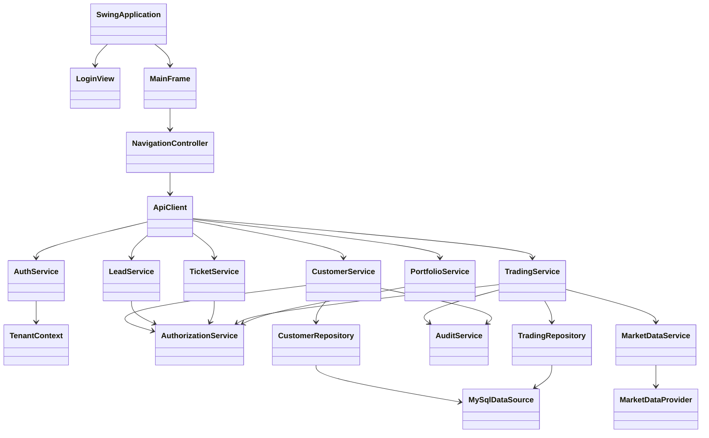

# CryptoVista X Enterprise
## Software Requirements Specification (SRS)

**Document version:** 1.0  
**Status:** Baseline specification for implementation  
**Date:** 06 November 2026  
**Product type:** Enterprise fintech desktop application with public marketing website  
**Primary platform:** Java Swing desktop client  
**Backend:** Java-based trusted application service  
**Database:** Shared MySQL 8  
**Architecture:** Multi-tenant, service-backed modular monolith  
**Authentication:** Password + TOTP multi-factor authentication  
**Market data:** Hybrid external reference data + deterministic mock provider  
**Trading mode:** Simulated trading only

---

## Document control

| Field | Value |
|---|---|
| Product | CryptoVista X Enterprise |
| Document | Software Requirements Specification |
| Version | 1.0 |
| Intended audience | Product owner, developers, database architect, UI/UX designer, QA, security reviewer and project evaluator |
| Scope | Public landing website, Swing desktop client, trusted application service, shared database and integrations |
| Approval | Pending stakeholder review |

### Revision history

| Version | Date | Description |
|---|---|---|
| 1.0 | 06-Nov-2026 | Initial consolidated enterprise SRS |

---

# 1. Introduction

## 1.1 Purpose

This document defines the functional and non-functional requirements for CryptoVista X Enterprise. It establishes the product scope, user roles, system context, workflows, security expectations, data requirements, interfaces, acceptance criteria and implementation constraints.

The SRS is the baseline for design, development, testing and project evaluation. Each requirement uses a stable identifier so that implementation and test evidence can be traced back to the specification.

## 1.2 Product vision

CryptoVista X Enterprise is a unified workspace for digital-asset market intelligence, simulated trading, portfolio analysis and enterprise customer relationship management.

The product combines four primary capabilities:

1. Market Intelligence: discover assets and inspect reference market information.
2. Simulated Trading: practice order entry and execution in a controlled environment.
3. Portfolio Intelligence: understand simulated holdings, balances, allocation and profit/loss.
4. Enterprise CRM and Operations: manage customers, leads, sales opportunities, onboarding, support, workflows, documents, subscriptions and operational reporting.

The public website explains the product and supports demo enquiries. The Java Swing application provides authenticated operational functionality.

## 1.3 Intended audience

- Product owner and project supervisor.
- Java developers.
- UI/UX designers.
- Database designers.
- Security reviewers.
- QA and test engineers.
- System administrators.
- Academic evaluators.

## 1.4 Definitions and abbreviations

| Term | Definition |
|---|---|
| Tenant | An organization using the shared application instance |
| Tenant-owned record | A business record belonging to one tenant |
| RBAC | Role-Based Access Control |
| ABAC | Attribute-Based Access Control |
| MFA | Multi-Factor Authentication |
| TOTP | Time-based One-Time Password |
| CRM | Customer Relationship Management |
| Customer 360 | Consolidated view of an authorized customer relationship |
| P&L | Profit and Loss |
| NAV | Net Asset Value |
| Ledger | Append-only record of simulated financial postings |
| Idempotency | Property that repeated submission of the same command does not create duplicate effects |
| SLA | Service Level Agreement |
| EDT | Swing Event Dispatch Thread |
| Reference price | Market information used for display and simulation input, not a guaranteed executable quote |
| Simulated order | An order processed by CryptoVista's internal simulation engine, not a real exchange |

## 1.5 References and assumptions

This SRS uses the finalized project decisions established in the project conversation. The Groww website is a visual and information-architecture reference for the public landing page only. CryptoVista X must have original branding, content, illustrations and interface layouts.

Where business policy has not been finalized, the requirement is marked as configurable or a decision is recorded in Section 20. No legal or regulatory compliance status is implied.

---

# 2. Overall Description

## 2.1 Product perspective

CryptoVista X consists of four logical layers:

1. Public website: unauthenticated product information, feature discovery, FAQs and demo enquiry.
2. Desktop client: Java Swing application used by authenticated organization members.
3. Trusted application service: validates identity, tenant context, authorization, business rules and transactions.
4. Persistence and integration layer: shared MySQL database, market-data adapters, notification adapters and file/document storage.

The Swing client must not connect directly to the production database. The trusted service is the security boundary.

### Logical architecture

```text
Public visitor
    |
    v
Public landing website
    |---- Product information
    |---- Demo enquiry
    |---- Help / FAQ

Authenticated employee
    |
    v
Java Swing desktop client
    |
    | HTTPS / authenticated API
    v
Trusted application service
    |---- Identity and MFA
    |---- Tenant context and authorization
    |---- CRM and sales services
    |---- Support and workflow services
    |---- Market and trading simulation
    |---- Portfolio and reporting
    |
    v
Repositories / transaction manager
    |
    v
Shared MySQL 8 database

External market data providers
    |
    v
Market data adapter / cache / freshness validation
    |
    v
Market reference data service
```

## 2.2 Product boundaries

CryptoVista X is not a real cryptocurrency exchange, broker, custodial wallet or payment processor.

- All balances, orders, fills, holdings and trading P&L are simulated.
- The system does not execute orders on external exchanges.
- The system does not hold customer crypto assets or private keys.
- External market prices are reference information only.
- No real deposits or withdrawals are supported.
- CRM sales opportunities concern software subscriptions, licences and services.
- Onboarding and identity-verification demonstrations must use synthetic data unless a separately approved compliant integration is introduced.

## 2.3 Operating environment

| Component | Requirement |
|---|---|
| Desktop OS | Windows 10/11 initially; Java-compatible Linux/macOS may be considered |
| Java runtime | Java 21 |
| Desktop UI | Java Swing/AWT |
| Database | MySQL 8 |
| Connectivity | HTTPS to trusted application service |
| Build | Maven or Gradle, based on existing repository |
| Time handling | Store timestamps in UTC; display in user/tenant timezone |
| Browser | Current mainstream browsers for the public website |
| Deployment | Desktop client installation plus trusted service deployment |

## 2.4 User classes

| User class | Description |
|---|---|
| Visitor | Unauthenticated person exploring public website |
| Demo requester | Visitor submitting a product demonstration enquiry |
| Tenant owner | Organization owner managing tenant settings and administrators |
| Tenant administrator | Manages users, roles, teams and tenant configuration |
| Security administrator | Reviews access, sessions, MFA and audit events |
| CRM manager | Oversees customers, leads, opportunities and CRM configuration |
| Sales representative | Manages assigned leads, accounts and opportunities |
| Support agent | Handles assigned support tickets and customer communication |
| Support manager | Manages queues, SLA, escalations and complaints |
| Customer success manager | Manages onboarding, health, retention and success plans |
| Market analyst | Reviews market reference data and asset watchlists |
| Trading user | Uses simulated trading features |
| Portfolio analyst | Reviews portfolio valuation and performance |
| Auditor/read-only user | Reviews permitted records, reports and audit events |
| System operator | Monitors application health and technical operations, without unrestricted business-data access by default |

A user may hold multiple roles, but permissions must be explicitly granted and evaluated by the trusted service.

## 2.5 Design and UX principles

The public landing page should follow a clear product-discovery sequence inspired by leading fintech websites such as Groww, while maintaining a unique CryptoVista identity.

Required public page sequence:

1. Compact navigation.
2. Product-focused hero with a real product preview.
3. Four product families.
4. Market intelligence preview.
5. Simulated trading preview.
6. Portfolio intelligence preview.
7. Enterprise CRM preview.
8. Enterprise operations.
9. Security and access control.
10. Product capability catalogue.
11. Authentic use cases, not fabricated testimonials.
12. FAQ.
13. Final demo/product CTA.
14. Comprehensive footer.

Visual direction: light-first, white and neutral grey surfaces, restrained green accent, readable dark typography, fine borders, rectangular controls, minimal shadows, no purple gradients, no emoji, no pill-shaped controls and no copied Groww assets or text.

The Swing application should use the same brand tokens and information hierarchy.

---

# 3. Scope

## 3.1 In scope

### Public website
- Product landing page.
- Product family sections.
- Feature overview pages or anchored sections.
- Security overview.
- FAQs.
- Request-demo form.
- Sign-in entry point.
- Privacy and terms placeholder pages subject to legal review.
- Responsive behavior and accessibility.

### Identity and tenant administration
- User accounts.
- Password authentication.
- TOTP MFA.
- Session management.
- Tenant membership.
- Roles and permissions.
- Team and department administration.
- Audit events.

### CRM
- Customer and account management.
- Contacts.
- Leads.
- Lead assignment and conversion.
- Activities and interaction timeline.
- Duplicate detection/review.
- Opportunities and sales pipeline.
- Customer onboarding.
- Support tickets.
- SLA and escalation.
- Complaints.
- Customer success plans and health indicators.
- Customer communications and consent preferences.

### Enterprise operations
- Workflow and approval management.
- Documents and knowledge base.
- Subscription and invoice records.
- Vendor records.
- Employee and team records.
- Reporting and analytics.
- Notifications.
- Audit and access review.

### Market and portfolio
- Asset catalogue.
- Hybrid market data.
- Watchlists.
- Asset detail and price history.
- Portfolio accounts.
- Simulated balances.
- Holdings and valuation.
- P&L calculations.
- Portfolio snapshots and reports.

### Simulated trading
- Market and limit orders.
- Order validation.
- Internal order book/matching.
- Partial and complete fills.
- Fees and slippage simulation.
- Order history.
- Trade history.
- Ledger postings.
- Idempotent order submission.

## 3.2 Out of scope

- Real cryptocurrency exchange connectivity for order execution.
- Real asset custody.
- Wallet private-key storage.
- Blockchain signing.
- Deposits and withdrawals.
- Fiat payment processing.
- Investment advice or guaranteed returns.
- Real KYC/AML decisioning.
- Tax filing.
- Regulatory certification claims.
- Microservice deployment unless separately approved.
- Public customer self-service portal unless separately approved.
- Mobile native application in the initial release.

## 3.3 Release priorities

| Priority | Meaning |
|---|---|
| P0 | Essential for secure usable baseline |
| P1 | Required for complete core product |
| P2 | Valuable enterprise enhancement |
| P3 | Advanced or optional capability |

---

# 4. Functional Requirements

## 4.1 Public website

| ID | Requirement | Priority |
|---|---|---|
| WEB-001 | The website shall display the CryptoVista X brand, product positioning and primary navigation. | P0 |
| WEB-002 | The homepage shall explain Market Intelligence, Trading Simulation, Portfolio Intelligence and Enterprise CRM. | P0 |
| WEB-003 | The homepage shall include a product preview using clearly labeled sample or authorized data. | P0 |
| WEB-004 | The homepage shall explain that trading is simulated and no real cryptocurrency is held or traded. | P0 |
| WEB-005 | Navigation links shall lead to valid sections or routes. | P0 |
| WEB-006 | The Request Demo action shall open a validated enquiry form. | P1 |
| WEB-007 | The enquiry form shall collect only necessary contact and organization details. | P1 |
| WEB-008 | The website shall provide an FAQ section with accessible expand/collapse behavior. | P1 |
| WEB-009 | The website shall provide product, security, contact and legal-information navigation. | P1 |
| WEB-010 | The website shall adapt to desktop, tablet and mobile viewport sizes. | P0 |
| WEB-011 | The website shall meet basic accessibility requirements for keyboard use, labels, focus and contrast. | P1 |
| WEB-012 | The website shall not display fabricated customer counts, testimonials, logos or certifications. | P0 |
| WEB-013 | The website shall not expose database credentials or connect directly to MySQL. | P0 |

## 4.2 Authentication and identity

| ID | Requirement | Priority |
|---|---|---|
| AUTH-001 | The system shall authenticate users using an individual account identifier and password. | P0 |
| AUTH-002 | Passwords shall be stored using a modern password hashing algorithm such as Argon2id or BCrypt. | P0 |
| AUTH-003 | The system shall require TOTP MFA according to tenant security policy. | P0 |
| AUTH-004 | The system shall support secure TOTP enrollment and verification. | P0 |
| AUTH-005 | MFA recovery codes shall be random, single-use and stored as hashes. | P1 |
| AUTH-006 | The system shall rate-limit repeated authentication and MFA failures. | P0 |
| AUTH-007 | The system shall create a secure session after successful authentication and MFA. | P0 |
| AUTH-008 | Sessions shall expire after configured inactivity and maximum lifetime. | P0 |
| AUTH-009 | Users shall be able to sign out and revoke their own active session. | P0 |
| AUTH-010 | Authorized administrators shall be able to disable accounts and revoke sessions. | P1 |
| AUTH-011 | Password reset tokens shall be random, expiring, single-use and stored hashed. | P1 |
| AUTH-012 | Password reset or account disable shall invalidate applicable sessions. | P0 |
| AUTH-013 | The system shall record authentication success, failure, MFA and session-security events. | P0 |
| AUTH-014 | The system shall not reveal whether an account exists through password-reset responses. | P1 |

## 4.3 Tenant and organization management

| ID | Requirement | Priority |
|---|---|---|
| TEN-001 | The system shall support multiple organizations using one shared MySQL database. | P0 |
| TEN-002 | Each tenant-owned business record shall be associated with a tenant identifier. | P0 |
| TEN-003 | Tenant context shall be derived from authenticated membership, not trusted from client input. | P0 |
| TEN-004 | Service queries shall enforce tenant scope for reads and writes. | P0 |
| TEN-005 | Cross-tenant record access shall be denied even when an identifier is guessed. | P0 |
| TEN-006 | Tenant administrators shall manage permitted tenant profile settings. | P1 |
| TEN-007 | Tenant administrators shall manage users and memberships within their tenant. | P0 |
| TEN-008 | Tenant administrators shall manage teams and departments within granted permissions. | P1 |
| TEN-009 | Tenant-level settings shall define timezone, base currency, session policy and trading simulation policy. | P1 |
| TEN-010 | Tenant suspension shall prevent ordinary tenant access according to policy. | P1 |

## 4.4 Authorization and access control

| ID | Requirement | Priority |
|---|---|---|
| IAM-001 | The system shall support role-based access control. | P0 |
| IAM-002 | The system shall support attribute-based conditions where role alone is insufficient. | P0 |
| IAM-003 | Permissions shall be checked by the trusted service for every protected operation. | P0 |
| IAM-004 | The system shall support least-privilege role assignment. | P0 |
| IAM-005 | The system shall support user, role, permission and membership administration. | P1 |
| IAM-006 | Sensitive fields shall be restricted by permission and business purpose. | P1 |
| IAM-007 | Exports shall require explicit permission and be audited. | P0 |
| IAM-008 | UI navigation may hide unavailable actions, but UI visibility shall not replace service authorization. | P0 |
| IAM-009 | Privileged actions may require step-up authentication according to policy. | P2 |

## 4.5 Customer, account and contact management

| ID | Requirement | Priority |
|---|---|---|
| CRM-CUS-001 | Authorized users shall create, view, update and archive customer records. | P0 |
| CRM-CUS-002 | Customer records shall have tenant-scoped unique identifiers. | P0 |
| CRM-CUS-003 | Customer records shall support individual and organization customer types. | P1 |
| CRM-CUS-004 | The system shall store lifecycle stage, owner, status and source. | P0 |
| CRM-CUS-005 | The system shall support customer search, filtering, sorting and pagination. | P0 |
| CRM-CUS-006 | The system shall support duplicate detection using configurable matching fields. | P1 |
| CRM-CUS-007 | Authorized users shall review and resolve potential duplicates. | P1 |
| CRM-ACC-001 | Users shall create and manage organization/account records. | P1 |
| CRM-ACC-002 | An account may be associated with multiple contacts and opportunities. | P1 |
| CRM-CON-001 | Users shall create and manage contacts associated with customer/account records. | P1 |
| CRM-CON-002 | Contact preferences and communication consent shall be recorded. | P1 |
| CRM-CUS-008 | Material customer changes shall be auditable. | P0 |

## 4.6 Leads and sales pipeline

| ID | Requirement | Priority |
|---|---|---|
| CRM-LEAD-001 | Authorized users shall create and manage leads. | P0 |
| CRM-LEAD-002 | Leads shall support source, status, owner, priority and qualification details. | P1 |
| CRM-LEAD-003 | Leads shall be assignable to authorized users or teams. | P1 |
| CRM-LEAD-004 | The system shall record lead status history. | P1 |
| CRM-LEAD-005 | The system shall support lead conversion into customer/account/contact and opportunity records. | P0 |
| CRM-LEAD-006 | Lead conversion shall be transactional and prevent duplicate conversion. | P0 |
| CRM-OPP-001 | Users shall create and manage sales opportunities. | P1 |
| CRM-OPP-002 | Opportunities shall support stage, expected value, currency, expected close date, owner and probability. | P1 |
| CRM-OPP-003 | The system shall display a pipeline board or equivalent stage-based view. | P1 |
| CRM-OPP-004 | Stage changes shall be validated and recorded in history. | P1 |
| CRM-OPP-005 | Configured opportunity changes shall support approval workflows. | P2 |
| CRM-OPP-006 | Pipeline reports shall be tenant-scoped and permission-checked. | P1 |
| CRM-ACT-001 | Users shall log calls, meetings, tasks, notes and follow-ups. | P1 |
| CRM-ACT-002 | Activities shall be linked to relevant customer, lead or opportunity records. | P1 |

## 4.7 Customer onboarding and success

| ID | Requirement | Priority |
|---|---|---|
| CS-ONB-001 | Authorized users shall create onboarding cases for customers. | P1 |
| CS-ONB-002 | Onboarding shall support configurable stages and task checklists. | P1 |
| CS-ONB-003 | Onboarding task assignment and due dates shall be recorded. | P1 |
| CS-ONB-004 | The system shall record onboarding completion and blockers. | P1 |
| CS-SUC-001 | Customer success managers shall create success plans. | P2 |
| CS-SUC-002 | Success plans shall support goals, milestones, owners and due dates. | P2 |
| CS-SUC-003 | The system shall calculate configurable customer-health indicators from documented factors. | P2 |
| CS-SUC-004 | Health indicators shall show their contributing factors and last calculation time. | P2 |
| CS-SUC-005 | Retention and renewal tasks shall be trackable. | P2 |

## 4.8 Support, complaints and SLA

| ID | Requirement | Priority |
|---|---|---|
| SUP-001 | Authorized users shall create and manage support tickets. | P0 |
| SUP-002 | Tickets shall include tenant, customer, subject, description, category, priority, status and assignee. | P0 |
| SUP-003 | Tickets shall support queues and assignment. | P1 |
| SUP-004 | Tickets shall support internal notes distinct from customer-visible messages. | P0 |
| SUP-005 | Tickets shall support status transitions with validation. | P0 |
| SUP-006 | The system shall calculate SLA deadlines using configurable business calendars and priority rules. | P1 |
| SUP-007 | The system shall warn on approaching or breached SLA deadlines. | P1 |
| SUP-008 | Managers shall reassign and escalate tickets within permission. | P1 |
| SUP-009 | Users shall create and track complaint cases. | P1 |
| SUP-010 | Ticket and complaint history shall be auditable. | P0 |
| SUP-011 | Customer-visible messages shall be distinguishable from internal notes. | P0 |

## 4.9 Communications and consent

| ID | Requirement | Priority |
|---|---|---|
| COM-001 | The system shall record communication preferences and consent state. | P1 |
| COM-002 | Users shall log permitted customer interactions. | P1 |
| COM-003 | Campaign recipients shall be filtered against applicable consent and suppression rules. | P1 |
| COM-004 | Campaign dispatch shall be disabled until a real provider is configured and tested. | P1 |
| COM-005 | Communication delivery state shall distinguish queued, sent, delivered, failed and unknown where supported. | P2 |
| COM-006 | The system shall not display a false delivery confirmation. | P0 |

## 4.10 Workflow and approvals

| ID | Requirement | Priority |
|---|---|---|
| WF-001 | Authorized administrators shall define supported workflow rules. | P2 |
| WF-002 | Workflows shall support trigger, condition, action and outcome definitions. | P2 |
| WF-003 | Approval requests shall record requester, approver, decision, reason and timestamps. | P1 |
| WF-004 | Approval actions shall verify the approver's current permissions. | P0 |
| WF-005 | Workflow execution shall be idempotent where retries are possible. | P1 |
| WF-006 | Failed workflow actions shall be visible and retryable by authorized users. | P2 |
| WF-007 | Workflow changes shall be versioned and audited. | P2 |

## 4.11 Documents and knowledge base

| ID | Requirement | Priority |
|---|---|---|
| DOC-001 | Authorized users shall upload and manage permitted documents. | P1 |
| DOC-002 | Documents shall be associated with tenant and permitted business records. | P1 |
| DOC-003 | Document downloads shall be authorized by the trusted service. | P0 |
| DOC-004 | File metadata shall include uploader, timestamp, type, size and storage reference. | P1 |
| DOC-005 | File type and size shall be validated. | P1 |
| DOC-006 | Sensitive document access shall be audited. | P1 |
| DOC-007 | The knowledge base shall support articles, categories, search and publication status. | P2 |
| DOC-008 | Storage shall not rely on publicly guessable file paths. | P0 |

## 4.12 Subscription, invoice and vendor records

| ID | Requirement | Priority |
|---|---|---|
| FIN-001 | Authorized users shall maintain subscription records for customer software plans. | P2 |
| FIN-002 | Subscription records shall support plan, start/end dates, status and renewal date. | P2 |
| FIN-003 | Authorized users shall maintain invoice records and status. | P2 |
| FIN-004 | Invoice records shall not imply payment collection unless a payment integration exists. | P0 |
| VEN-001 | Authorized users shall create and maintain vendor records. | P2 |
| VEN-002 | Vendor records shall support contacts, status and internal notes. | P2 |
| VEN-003 | Vendor changes shall be audited. | P2 |

## 4.13 Market intelligence

| ID | Requirement | Priority |
|---|---|---|
| MKT-001 | The system shall maintain a supported digital-asset catalogue. | P0 |
| MKT-002 | The system shall retrieve market reference data through provider adapters. | P1 |
| MKT-003 | The system shall support a deterministic mock provider for development and demonstrations. | P0 |
| MKT-004 | Each displayed price shall identify asset, quote currency, source and observation timestamp. | P0 |
| MKT-005 | The system shall identify stale, unavailable or mock market data. | P0 |
| MKT-006 | Users shall search and filter assets. | P1 |
| MKT-007 | Users shall maintain personal or permitted shared watchlists. | P1 |
| MKT-008 | The system shall display available historical price points. | P1 |
| MKT-009 | Provider failures shall not silently replace real prices with unlabeled mock values. | P0 |
| MKT-010 | External market data shall be treated as reference information, not an executable exchange quote. | P0 |

## 4.14 Simulated trading

| ID | Requirement | Priority |
|---|---|---|
| TRD-001 | The system shall support simulated trading accounts. | P0 |
| TRD-002 | Each account shall have a configurable virtual starting balance. | P0 |
| TRD-003 | The system shall support market and limit orders in the baseline release. | P0 |
| TRD-004 | The system shall validate available simulated balance and order parameters before acceptance. | P0 |
| TRD-005 | The system shall generate an order preview before submission. | P0 |
| TRD-006 | The system shall execute accepted orders through an internal simulation engine only. | P0 |
| TRD-007 | The simulation engine shall support complete and partial fills where applicable. | P1 |
| TRD-008 | The system shall record order state transitions. | P0 |
| TRD-009 | The system shall record fills, fees and simulated slippage. | P1 |
| TRD-010 | Order submission shall use an idempotency key. | P0 |
| TRD-011 | Order, fill, fee and ledger postings shall be transactionally consistent. | P0 |
| TRD-012 | The system shall prevent available simulated balances from becoming negative. | P0 |
| TRD-013 | Users shall view open orders, order history and trade history. | P0 |
| TRD-014 | Users shall cancel eligible open orders. | P1 |
| TRD-015 | Every trading screen shall disclose that execution is simulated. | P0 |

## 4.15 Portfolio intelligence

| ID | Requirement | Priority |
|---|---|---|
| PORT-001 | The system shall display total simulated portfolio value. | P0 |
| PORT-002 | The system shall display invested capital and available simulated cash. | P0 |
| PORT-003 | The system shall display asset holdings and quantities. | P0 |
| PORT-004 | The system shall calculate realized and unrealized P&L. | P0 |
| PORT-005 | The system shall calculate P&L margin/return using a documented denominator and method. | P0 |
| PORT-006 | The system shall display asset allocation. | P1 |
| PORT-007 | The system shall store portfolio valuation snapshots. | P1 |
| PORT-008 | The system shall display historical performance for supported periods. | P1 |
| PORT-009 | Portfolio totals shall reconcile to ledger balances and selected market-price snapshots. | P0 |
| PORT-010 | Users shall view trade entry logs and transaction history. | P0 |
| PORT-011 | The system shall identify stale or missing prices used in valuation. | P0 |
| PORT-012 | Portfolio reports shall be tenant- and permission-scoped. | P0 |

## 4.16 Analytics and reporting

| ID | Requirement | Priority |
|---|---|---|
| RPT-001 | The system shall provide role-appropriate dashboards. | P1 |
| RPT-002 | CRM reports shall include customer, lead, opportunity and activity metrics. | P1 |
| RPT-003 | Support reports shall include ticket volume, aging and SLA metrics. | P1 |
| RPT-004 | Trading reports shall include order and fill history for simulated activity. | P1 |
| RPT-005 | Portfolio reports shall include holdings, allocation and performance. | P1 |
| RPT-006 | Report filters shall be tenant-scoped and permission-checked. | P0 |
| RPT-007 | Exports shall require explicit permission and create audit events. | P0 |
| RPT-008 | Reports shall identify date range, timezone, currency and data freshness where relevant. | P1 |
| RPT-009 | Export jobs shall have status and error reporting. | P2 |

## 4.17 Notifications

| ID | Requirement | Priority |
|---|---|---|
| NOT-001 | The system shall display in-application notifications for relevant events. | P1 |
| NOT-002 | Users shall mark notifications read or unread. | P1 |
| NOT-003 | Notifications shall respect tenant and user permissions. | P0 |
| NOT-004 | Email notifications shall require a configured provider. | P2 |
| NOT-005 | Notification failures shall be logged without falsely reporting delivery. | P0 |

## 4.18 Audit and security operations

| ID | Requirement | Priority |
|---|---|---|
| AUD-001 | The system shall record material business and security actions. | P0 |
| AUD-002 | Audit records shall include actor, tenant, action, entity, time, result and correlation ID where available. | P0 |
| AUD-003 | Ordinary users shall not modify or delete audit records. | P0 |
| AUD-004 | Audit search shall be permission-controlled and tenant-scoped. | P0 |
| AUD-005 | The system shall record role, permission and tenant configuration changes. | P0 |
| AUD-006 | The system shall record sensitive export and document access events. | P1 |
| AUD-007 | Logs shall not contain passwords, MFA codes, session tokens or secret values. | P0 |

---

# 5. Non-Functional Requirements

## 5.1 Performance Targets

| ID | Requirement | Target |
|---|---|---|
| NFR-PERF-001 | Standard desktop navigation shall respond promptly. | Target under 2 seconds excluding network/provider delays |
| NFR-PERF-002 | Typical paginated CRM list query shall complete. | Target under 2 seconds for agreed test dataset |
| NFR-PERF-003 | Standard dashboard shall render. | Target under 3 seconds for agreed test dataset |
| NFR-PERF-004 | Slow service operations shall not freeze the Swing EDT. | No blocking network/database call on EDT |
| NFR-PERF-005 | Large exports shall run asynchronously. | User receives job status |

---

# 6. Database ERD (Logical Architecture)

```mermaid
erDiagram
    TENANTS ||--o{ TENANT_MEMBERSHIPS : has
    USERS ||--o{ TENANT_MEMBERSHIPS : joins
    TENANTS ||--o{ ROLES : defines
    ROLES ||--o{ USER_ROLES : assigned
    USERS ||--o{ USER_ROLES : receives
    ROLES ||--o{ ROLE_PERMISSIONS : grants
    PERMISSIONS ||--o{ ROLE_PERMISSIONS : included
    USERS ||--o{ USER_SESSIONS : owns
    USERS ||--o{ MFA_CREDENTIALS : enrolls

    TENANTS ||--o{ CUSTOMERS : owns
    TENANTS ||--o{ ACCOUNTS : owns
    CUSTOMERS ||--o{ CONTACTS : relates
    ACCOUNTS ||--o{ CONTACTS : contains
    TENANTS ||--o{ LEADS : owns
    LEADS ||--o| OPPORTUNITIES : converts_to
    CUSTOMERS ||--o{ OPPORTUNITIES : has
    USERS ||--o{ ACTIVITIES : performs
    CUSTOMERS ||--o{ ACTIVITIES : records

    CUSTOMERS ||--o{ SUPPORT_TICKETS : raises
    SUPPORT_TICKETS ||--o{ TICKET_MESSAGES : contains
    SUPPORT_TICKETS ||--o{ TICKET_STATUS_HISTORY : tracks
    SUPPORT_TICKETS ||--o{ SLA_EVENTS : measures

    CUSTOMERS ||--o{ ONBOARDING_CASES : has
    ONBOARDING_CASES ||--o{ ONBOARDING_TASKS : contains
    CUSTOMERS ||--o{ SUCCESS_PLANS : has

    TENANTS ||--o{ ASSETS : configures
    TENANTS ||--o{ TRADING_ACCOUNTS : owns
    TRADING_ACCOUNTS ||--o{ ORDERS : submits
    ORDERS ||--o{ FILLS : produces
    TRADING_ACCOUNTS ||--o{ LEDGER_JOURNALS : posts
    LEDGER_JOURNALS ||--o{ LEDGER_ENTRIES : contains
    TRADING_ACCOUNTS ||--o{ PORTFOLIO_SNAPSHOTS : snapshots
    ASSETS ||--o{ MARKET_PRICE_SNAPSHOTS : priced_by

    TENANTS ||--o{ WORKFLOW_DEFINITIONS : configures
    WORKFLOW_DEFINITIONS ||--o{ WORKFLOW_INSTANCES : starts
    WORKFLOW_INSTANCES ||--o{ WORKFLOW_TASKS : creates
    TENANTS ||--o{ DOCUMENTS : stores
    TENANTS ||--o{ AUDIT_EVENTS : records
```



---

# 7. UML Application Architecture



